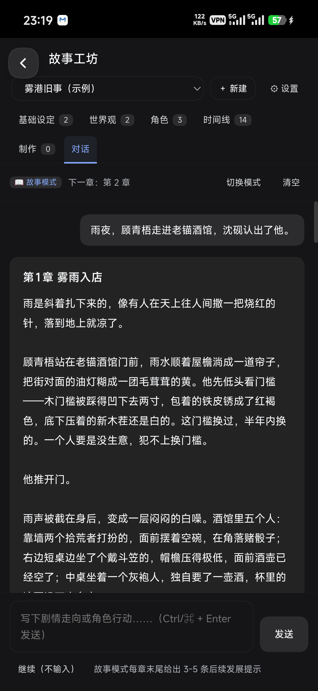
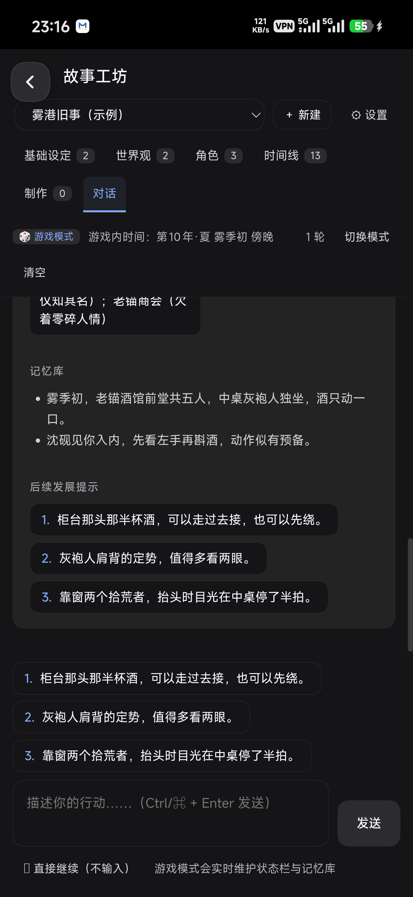
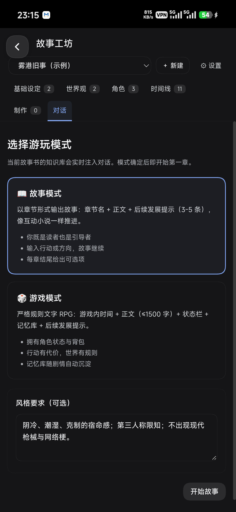
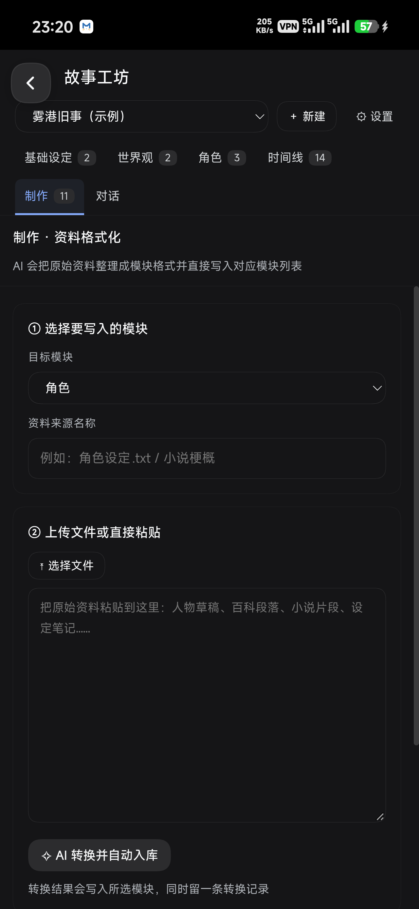

# 故事工坊（dsh-storybook）

**更简单的 AI 小说互动工具** —— 装进 DSH Web UI 的故事工坊。

仓库：<https://github.com/lusrelay/dsh_storybook> · CI：[](https://github.com/lusrelay/dsh_storybook/actions/workflows/ci.yml)

一个装在 DSH Web UI 里的「酒馆式」故事创作插件：每本故事书拥有彼此隔离的六大模块，
模块内容自动成为对话的知识库，并用当前默认模型完成时间线整理、资料格式化与双模式叙事。

左侧栏新增「故事工坊」图标，主面板是一整页工作台。



<details>
<summary>更多截图（游戏模式 / 模式选择 / 时间线 / 制作）</summary>






</details>

- **六大模块**：基础设定 / 世界观 / 角色 / 时间线 / 制作 / 对话，一本书一套，互不引用
- **知识库不靠全量塞**：关键词索引 + 三级触发检索，每轮只注入相关片段（实测 1849 字 vs 旧版 12000 字上限）
- **双模式**：故事模式按章节输出；游戏模式带实时状态栏、记忆库与 ≤1500 字正文
- **AI 流水线**：导入即知识库、资料格式化入库、时间线自动整理、对话后自动沉淀记忆

## 七个需求的落点

| 需求 | 实现 |
| --- | --- |
| 1. 六大模块 | `基础设定 / 世界观 / 角色 / 时间线 / 制作 / 对话` 六个页签；基础设定写的是**系统提示词**，其余是知识条目 + 编辑器 |
| 2. 上传或直输 | 模块页「上传文件」可多选 `.txt/.md/.json/.csv/.yaml`，读成文本后自动生成知识条目；也可直接新建条目输入 |
| 3. 时间线 | 两种填法：**手动填写**逐条编辑，或**自动生成**读取世界观 + 角色提取事件（追加 / 覆盖两种策略，改动后会提示已过期）；每次对话后自动沉淀「记忆/章节梗概」 |
| 4. 制作 | 上传或粘贴原始资料 → 选择目标模块 → AI 按模块格式整理成条目 → **自动写入该模块**，并保留一条转换记录 |
| 5. 对话 | 每轮把五个模块拼成知识库（有字符预算，按基础设定→世界观→角色→制作→最近时间线排序）注入系统提示 |
| 6. 隔离 | 每本故事书一个 JSON 文件；所有接口以 `bookId` 寻址，跨书读写直接报错；UI 切换书籍即切换全部数据 |
| 7. 双模式 | 开始对话前先选模式：故事模式 = 章节名 + 正文 + 3-5 条后续发展提示；游戏模式 = 游戏内时间 + 正文(≤1500 字) + 状态栏 + 记忆库 + 后续发展提示 |

## 目录

```
dsh-storybook/
├── package.json          # dsh.bundle.patch + dsh.client（web 半身）
├── cordis.patch.yml      # 插入一行 plugin: storybook
├── index.js              # Host：JSON 存储、关键词索引、ctx.llm 调用、/storybook/api
├── client.js             # Client：sidebar.panellist + main 面板，整页 React UI（无 JSX）
├── icon.svg              # 插件卡片图标
├── locale/{zh,en}.json   # 插件卡片标题/简介
├── screenshots/          # README 用图
├── tests/                # Host / 容错 / 索引 / 时间线 / 多对话 / 前端渲染 六套用例（零依赖）
└── .github/workflows/ci.yml
```

## 安装

DSHA 要求插件安装由用户确认（原生审阅），所以有两种装法：

**A. 本地压缩包**（推荐给离线/自用）

1. 打包：`zip -r dsh-storybook.zip index.js client.js cordis.patch.yml package.json icon.svg locale -x '*.DS_Store'`，或直接下载 Release 里的 zip；
2. DSHA → 底部「插件」→「插件管理」→「导入压缩包」→ 选中 zip；
3. 核对作者/版本/依赖后确认安装；
4. 若列表里显示「待审阅/已停用」，再点它 →「审阅/启用」；
5. 重启 DSHA Web，左侧栏出现「故事工坊」。

**B. 直接指向 GitHub 仓库**

插件管理里支持从仓库/Release 安装，把仓库地址（或 `owner/repo`、Release 里的 zip 链接）粘进去，
同样走「解析 → 预览 → 确认 → 启用 → 重启」流程。本仓库根目录就是插件包，无需构建。

## 数据

- 位置：`$DSH_HOME/storybook/`（默认 `/root/.dsh/storybook/`）
  - `index.json`：书籍顺序与当前选中书
  - `books/<bookId>.json`：该书全部模块、对话、模式、状态
- 写入使用「临时文件 + rename」原子落盘，并按书串行化写队列；
- 删除书会删除对应文件，其他书不受影响。

## 模型

- 模型来源：`ctx.llm.stream()` + `agentDefaultModel.currentSelection()`，即「设置 → 模型」里选的默认模型；
- 三类调用：时间线整理（temperature 0.3，JSON）、资料格式化（0.3，JSON）、对话（0.95）；
- 知识库预算、风格要求、是否自动沉淀记忆都在「设置」里可调。

## 开发与测试

零构建、零依赖：Host 是 ESM，Client 是 `window.__ModuleLoader__.load` 包一层。

```bash
npm run check   # node --check index.js client.js
npm test        # 四套用例，全部自带临时 DSH_HOME，不碰真实数据
```

| 用例 | 覆盖 |
| --- | --- |
| `tests/host.test.mjs` | 建书/模块读写/文件导入/故事书隔离/时间线/制作/双模式/落盘 |
| `tests/resilience.test.mjs` | 空输出重试、截断 JSON 打捞、拒答提示、长文档分段 |
| `tests/index.test.mjs` | 关键词抽取、常驻/用户触发/AI 触发、预算上限、超长单行切段 |
| `tests/timeline.test.mjs` | 时间线同步状态、追加去重、覆盖只换 AI 事件、手动/记忆保留、模式持久化 |
| `tests/conversations.test.mjs` | 多对话隔离、流式 SSE、分支、重新输入、对话删除与记忆清理 |
| `tests/client.test.mjs` | 用最小 React 垫片渲染面板（故事列表 / 对话头 / 双模式 / 时间线范围） |

CI 在 Node 20/22 上跑同样的命令。

## 已知边界

- 上传只接受文本类文件（PDF/DOCX 请先转成 txt/md）；
- 对话为非流式请求，长章节生成时界面显示「正在续写…」；
- 解析器对模型格式有一定容错（兼容 `**【状态栏】**`、`# 状态栏` 等写法），完全跑偏时会退化为整段正文展示。

## 实机验证（2026-10-18，Android 手机端 DSH Web）

安装：原生插件管理导入 `dsh-storybook.zip` → 静态预览 → 确认 → 已启用（Host 热加载生效，无需重启）。

| 验证项 | 结果 |
| --- | --- |
| Host 接口 | `GET /storybook/api?action=state` → `{"books":[...],"activeBookId":...}` |
| 槽位注册 | `main` key=`storybook`、`sidebar.panellist` id=`storybook` 均 active |
| 侧栏入口 | 与「插件」并列出现「故事工坊」 |
| 时间线自动整理（真模型） | 世界观+角色 → 11 条事件（纪元前 300 年 → 第 10 年·夏） |
| 制作格式化（真模型） | 一段文风样本 → 10 条文风条目写入「制作」，并留 1 条转换记录 |
| 故事模式（真模型） | 第 1 章 雾雨入店：章节名 + 2181 字正文 + 4 条后续发展提示 |
| 游戏模式（真模型） | 第 10 年·夏 雾季初 傍晚 + 288 字正文 + 7 行状态栏 + 2 条记忆库 + 3 条提示；正文未超 1500 字 |
| 自动记忆 | 故事：每章 1 条章节梗概入时间线；游戏：每回合 2-4 条记忆入时间线 |
| 故事书隔离 | A 书看不到 B 书条目（接口层用例 + 单书一文件） |
| 离线用例 | Host 10 组（建书/条目/导入/隔离/时间线/制作/双模式/落盘）全绿；前端 7 组渲染用例全绿 |

截图见 `../screenshots/`。

### 本轮实机修掉的界面问题

1. 深色主题下主按钮白底白字 —— 主色从 `--dsw-alias-brand-primary`（该主题为白色）改为 `--dsw-alias-state-business-primary`，主按钮改宿主同款灰底胶囊；
2. 竖屏标题被左上角悬浮返回键压住 —— 页头拆成「标题行 + 工具行」，窄屏标题让出 46px；
3. 六个页签在 400+ CSS px 宽的手机上被截断 —— 窄屏改为两行换行；
4. 输入框上方与回复卡片内重复显示后续提示 —— 移除重复项；
5. `⏵` 在当前字体缺字 —— 改为纯文字「继续（不输入）」。

## 数据与状态

示例书《雾港旧事（示例）》：基础设定 2、世界观 2、角色 3、时间线 14、制作 11（含 1 条转换记录），当前处于故事模式第 2 章待续。删除按钮在「设置 → 删除本书」。

## 1.0.2：长文档转换失败修复

**现象**：在「制作」里转换 13k 字的 `奥菲墨.md`，第一次提示「模型没有返回内容」，再试提示「没有可解析的 JSON」。

**根因**：旧逻辑把整份资料一次性交给模型并要求输出 JSON。默认思考强度下，「思考 token + JSON 正文」共用同一个输出预算，13k 字输入容易把预算耗尽——要么只剩思考、正文为空（表现为「没有返回内容」），要么 JSON 写到一半被截断（表现为「无对应 JSON」）。这是概率性的，所以偶尔能成功。

**修复**：

| 改动 | 说明 |
| --- | --- |
| 分段转换 | ≤9000 字整段送；更长按行切成 ≤6000 字/段，逐段转换后合并、按标题去重 |
| 空输出重试 | 某段正文为空时自动重试一次（正好覆盖「模型无返回结果」） |
| 截断打捞 | JSON 不完整时逐个对象抢救，末条缺引号/右括号会尝试补齐 |
| 部分成功 | 某段失败只记 warning，其它段照常入库；结果卡片列出失败段落 |
| 错误可读 | 区分「被截断 / 只输出了思考 / 模型拒答 / 调用失败」，并给出下一步建议 |
| 对话同样加固 | 正文为空时给出可操作提示；`max-tokens` 标记 `truncated` |
| 上限与去重 | 单次入库上限 48 条，跨段同标题去重，已存在的完全重复条目跳过 |

**实测**：`奥菲墨.md`（13082 字）→ 3 段 → 36 条角色条目，62.9 秒，无失败段。

> 维护提醒：安装后的插件实体在 `$DSH_HOME/plugin-src/<name>`，**不要直接改安装目录里的文件**——原生管理器会判定完整性被破坏并自动停用（写入 `node_modules/<name>.disabled`）。升级请改源码 → 打包 zip → 在插件管理里「导入压缩包」重新审阅。

## 1.1.0：关键词索引、三级触发检索、长文档不再丢内容

### 1) 长文档丢失修复

旧版对一次转换有 `48 条` 硬上限，且按 12 条/段压缩，长过场文件会被截掉。现在：

- 单次入库上限改为 `settings.maxEntriesPerConvert`（默认 **400**，可在设置里调），达到上限时明确提示而不是静默丢弃；
- 每段最多 20 条，并要求「宁可拆成两条，也不要压成一条丢掉细节」；
- `splitSource` 对**超长单行**也做硬切（之前单行 15k 字会整段送、被模型输出上限截断）；
- 时间线整理同样按 9000 字分段提取，不再 `world.slice(0, 12000)` 隐式丢弃；
- 采集记录里写明分段数、入库数、失败段。

### 2) 关键词系统 + 索引

- 条目不只有标题/内容，新增 `keywords[]` 与 `always`（系统常驻）两个字段；
- 关键词来源三条路：导入时启发式抽取（引号专名 → 标题 → 高频汉字片段）、AI 转换时随条目一起生成、编辑器里手填；
- 模块工具栏「⚿ 关键词」调用模型批量补词（14 条/批，只补关键词不足的条目），页脚显示 `关键词 已覆盖/总数`；
- 索引是内存倒排表（关键词 → 条目），每轮对话按需重建，规模到千条仍是毫秒级。

### 3) 三级触发查询

| 触发 | 规则 | 预算 |
| --- | --- | --- |
| 系统触发 | 基础设定 + 标记「常驻」的条目 + 最近 6 条记忆，每轮必带，不需命中 | `residentBudget` 默认 2600 字 |
| 用户触发 | 玩家本轮输入命中关键词才检索注入，按命中长度 × 模块权重排序 | `retrievalBudget` 默认 4200 字，最多 10 条 |
| AI 触发 | 上一条助手回复命中关键词（说明叙事提到了它），下一轮补进上下文 | 约检索预算的 45%，最多 5 条 |

对话回复底部会显示：`本轮注入：3 条检索 + 4 条常驻 · 2180 字 · 命中关键词：… · 用户触发：… · AI 触发：…`，便于核对是否省了 token、有没有漏设定。

效果：以前每轮固定塞 `knowledgeBudget=12000` 字全量设定，现在常态 2-4k 字，且相关性更高；同一本书条目越长、对话越长，省得越多。

### 4) 兼容

- 旧书打开时自动补齐 `keywords/always` 字段（不会丢数据）；
- 旧条目没有关键词时仍可按标题命中，建议对存量书点一次「⚿ 关键词」。

### 1.1.0 实测（真模型，2026-10-18）

- **关键词回填**：`青猫诊所` 111 条 → 111 条补全，51.4 秒；`雾港旧事（示例）` 31 条 → 11.5 秒。样例：`流·黛膏与溶剂 → 黛膏、体液、青猫、溶剂`。
- **三级触发**（示例书，输入「顾青梧问沈砚：那把王城图书馆的钥匙，你从哪来的？」）：
  - 常驻 5 条（基础设定 + 主角 + 最近记忆）
  - 用户触发 10 条：人物草稿、主角：顾青梧、沈砚的观察顺序、老板娘收下钥匙 …
  - AI 触发 5 条：雾港设定、三大势力成形、地下金库落成、司岚起疑重查 …
  - 命中关键词 9 个，**注入 1849 字**（旧版固定最多 12000 字），同轮生成第 2 章 1938 字。
- **长文档**：3 万字符文档 = 5 段 × 20 条 = 100 条，无上限截断；15k 单行文本被硬切成 3 段，全部入库。

## 1.2.0：时间线手动 / 自动双模式

时间线不再只有「自动整理」一个按钮，而是两种填写方式并存：

- **手动填写**：和普通模块一样新增、编辑、删除；每条带「故事内时间」字段，可手填 `第10年·夏` 这类任意写法。
- **自动生成**：读取「世界观 + 角色」提取事件，两种处理方式：
  - **追加**：保留现有条目，只补新事件；生成时会把已有事件列表一并告诉模型，避免重复。
  - **覆盖**：先删掉上一次 AI 生成的事件再重建；**手动条目与对话沉淀的记忆永远保留**。
- **过期提示**：世界观/角色有任何改动，时间线会标记 `⚠ 设定有更新`；自动面板里显示来源条数、上次整理时间、上次策略与条数。
- **状态可查**：新增 `timeline/status` 接口，返回 `stale / syncedAt / strategy / counts{world, character, events, aiEvents, manualEvents, memories}`。
- 模式保存在书设置里（`settings.timelineMode`），切换后下次进来还是这个视图。

新增 `tests/timeline.test.mjs`（同步状态、追加去重、覆盖保留、模式持久化），CI 现在跑五套用例。

## 1.2.1：界面细节与基础设定定位

- **基础设定 = 系统提示词**：不再进检索池，整段以 `【系统提示词 · 来自「基础设定」】` 前置到 system prompt（在模式格式规则之前、知识片段之后），预算 `promptBudget`（默认 2400 字，设置里可调）。编辑器、空态说明、模块介绍同步改写，明确「在输出格式规则之内优先遵守」。
- **对话只显示用量**：去掉原来的「本轮注入 N 条 / 命中关键词 / 用户触发 / AI 触发」调试行，改为每条回复底部的 `↑ 输入 · ↓ 输出 tokens`（含思考 token），工具栏显示本段对话累计用量。
- **模块介绍收纳**：模块为空时显示完整介绍；已有条目时介绍收进「模块说明」折叠项，默认不占空间。编辑器底部说明按模块区分。
- 新增 `BUDGET`：`settings.promptBudget` 可在「设置」里调整。

## 1.3.0：对话模块升级为「故事」

- **多对话**：一本书可以有任意多个对话，默认 `对话1 / 对话2`，可随时改名；消息、章节计数、游戏状态、时间线记忆都按对话隔离，世界观/角色/手动事件全局共享。
- **进入式界面**：点开「故事」先看到对话列表；进入某个对话后其它模块折叠，只剩一条故事栏：`‹ 返回 · 对话名（点击改名） · ☰ 切换/新建 · ⚙ 设置`。
- **流式输出**：`chat/stream` 用 SSE 推送 `delta`，界面边生成边渲染，完成后落盘并回传用量。
- **对话级操作**（长按/右键）：重新输入（重生成上一条）、分支（从某条消息新建对话，连同该消息之前的记忆一起复制）、新建对话、删除当前对话（连它的时间线记忆一起清理）。
- **每对话设置**：温度、单次输出上限 maxTokens、上下文长度（历史消息条数）。
- **输入栏左侧**新增对话切换器，随时跳到另一条对话。
- **时间线范围**：默认「仅本对话」（共享事件 + 本对话沉淀的记忆），可切「全部对话」。
- 新增 `tests/conversations.test.mjs`，CI 跑六套用例。

## 1.3.1：修复长按 / 右键菜单点不动

- **根因**：菜单遮罩在 `mousedown` 阶段就 `setMenu(null)`，而 `click` 要等 `mouseup` 之后才派发——菜单在被点中前已经卸载，于是「新建对话 / 删除对话 / 重新输入 / 分支」全部表现为“点了没反应”；打开菜单的那一次触摸也会立刻把菜单关掉。
- **修复**：只有点在遮罩空白处才关闭；菜单容器拦截 `mousedown/touchstart` 冒泡；菜单刚打开的 260ms 内不响应“点外部”。
- 长按弹出菜单后会吞掉紧随的 `click`，避免“长按 = 进入对话”。
- 对话正文（消息、空白处）也支持长按 / 右键弹菜单。
- 新增 `pressProps` 单测：长按 480ms 弹出、click 抑制、短按不拦截。

## 1.4.0：返回键修正、用户消息可编辑、时间线竖轴

- **返回键**：故事内的返回按钮原来被宿主悬浮返回键盖住，点到的其实是 App 的返回（直接退出插件）。现在聊天头部让开 52px，并把按钮标成「‹ 列表」，点击回到故事列表；☰ 菜单里也有同名入口。
- **编辑用户消息**：长按/右键自己发的消息 → 编辑。可只改措辞（保留后续），也可勾选「同时删除之后的消息」，把剧情从这条重写——这些消息沉淀的时间线记忆会一并清理。
- **时间线竖轴**：时间线改成纵向时间轴，按故事内时间排序（纪元前 → 第 N 年 → 第 N 天 → 第 N 章 → 未标注），节点卡片显示时间/标题/摘要与来源标签；点击弹出详情，可编辑或删除；宽屏（≥760px）节点左右交替。
- **修复**：模块条目删除的确认弹窗之前没有执行回调（`onConfirm` 未被调用），导致删不掉；现在确认弹窗支持内联回调。
- 测试：新增编辑消息用例（截断 / 记忆清理 / 空消息拒绝）与时间线排序断言。

## 许可证

MIT，见 [LICENSE](LICENSE)。
